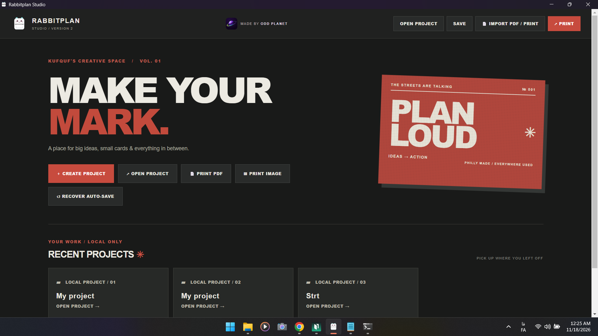
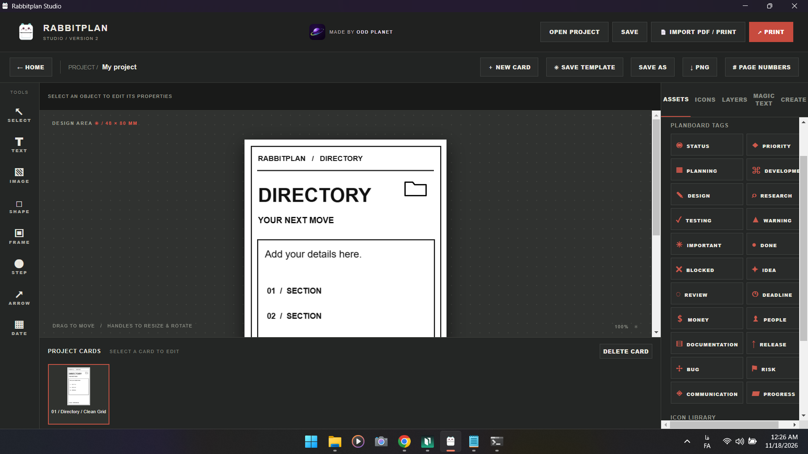
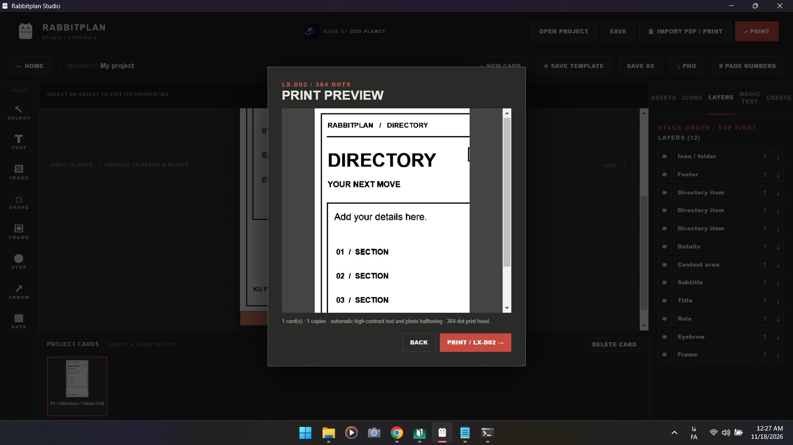

# RabbitPlan Studio 🐇

### A Free Windows Alternative to Funny Print

RabbitPlan Studio is an offline-first Windows application for designing, organizing, and printing content on 58mm mini thermal printers.

Create custom printable cards, project plans, notes, checklists, labels, and more. Arrange your content, customize templates, and print directly from your workspace.

**No cloud account required. Your projects stay on your device.**

---

## ✨ Features

- **Visual Project Management:** Organize your work into projects and editable cards.
- **Custom Card Templates:** Create and customize cards for goals, milestones, tasks, notes, phases, and status tracking.
- **Automatic Text Pagination:** Split long text into printable pages.
- **Icon Library:** Use built-in icons and custom icons.
- **Print Design:** Prepare and arrange content for mini thermal printers.
- **Image & PDF Printing:** Print supported visual and document formats.
- **Offline-First:** Work locally without requiring a cloud account.
- **Local Storage:** Keep your projects and data on your device.

---

## 🖼️ Screenshots

### Project Dashboard


### Card Editor


### Print Preview


###Card List


---

## 🖨️ Printer Compatibility

Designed for Windows users working with 58mm mini thermal printers.

RabbitPlan Studio is not limited to a single printer brand or model. Actual compatibility depends on the printer, its Windows driver, and connection method.

---

## 💻 Installation

1. Open the [Latest Release](https://github.com/Odd-Planet/RabbitPlan-Studio/releases/latest).
2. Download the Windows x64 installer.
3. Run the installer.
4. Launch RabbitPlan Studio.

---

## 🚀 Getting Started

1. Create a new project.
2. Choose or customize a card template.
3. Add your text, tasks, notes, or other content.
4. Arrange your cards.
5. Prepare and print your content.

---

## 🛠️ Development

Requirements:
- Windows 10/11
- Node.js
- npm

Run locally:

```bash
npm install
npm start
```

Build for Windows:

```bash
npm run build:win
```

---

## 🏢 Developed by ODD Planet

RabbitPlan Studio is an ODD Planet product.

- Organization: https://github.com/Odd-Planet
- Repository: https://github.com/Odd-Planet/RabbitPlan-Studio
- Releases: https://github.com/Odd-Planet/RabbitPlan-Studio/releases

---

## 📄 License

MIT License

Copyright (c) 2026 ODD Planet
